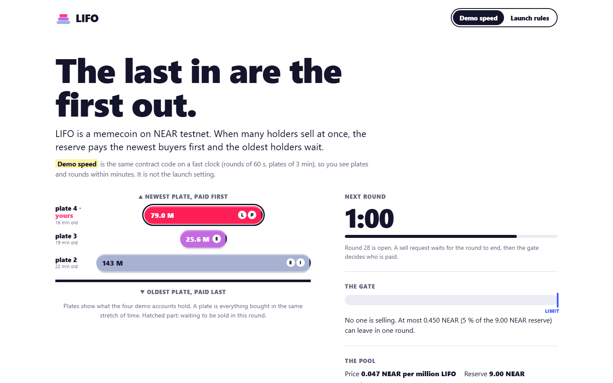
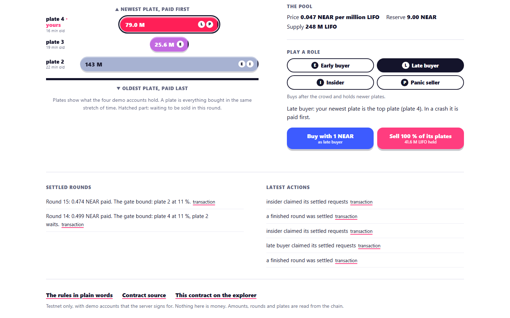
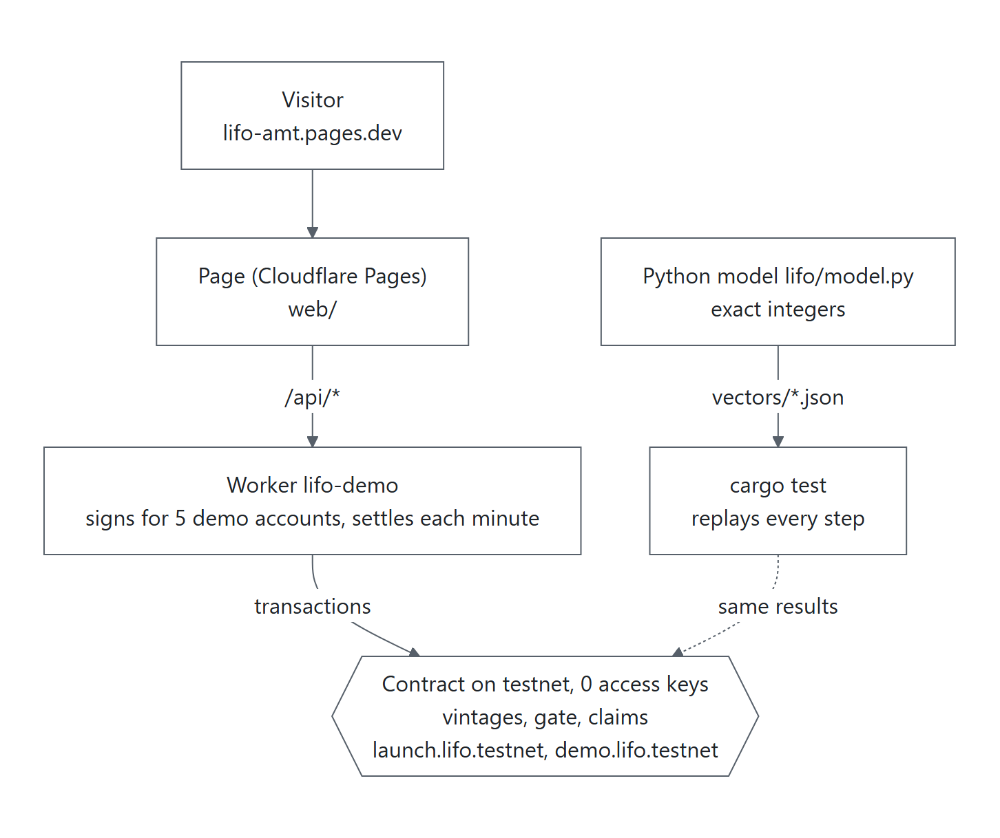
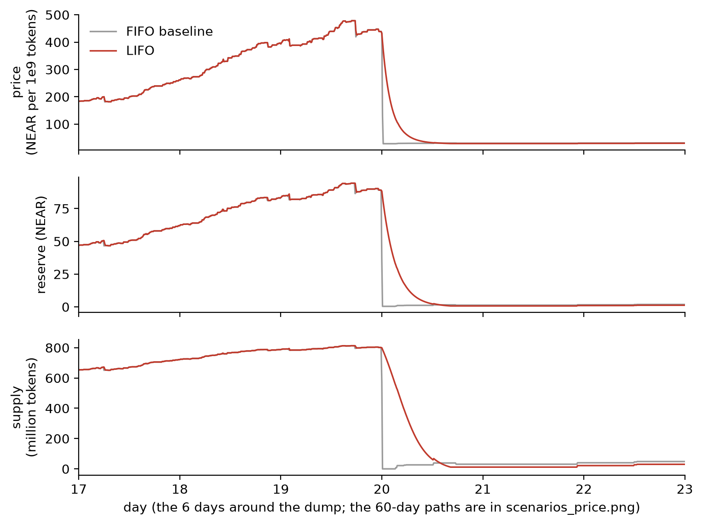
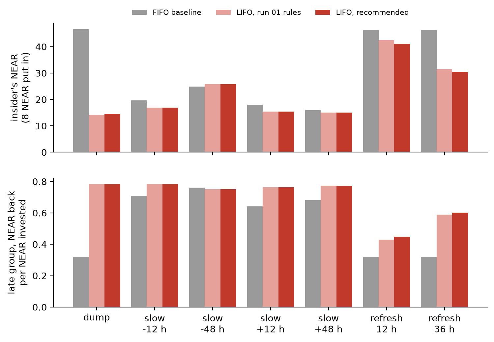

# LIFO

**LIFO is a memecoin on NEAR whose reserve pays the newest buyers first in a crash, so the earliest holders, not the latest, wait at the back of the line.**

[](https://github.com/Marc-Dvci/lifo/actions/workflows/tests.yml)
[](https://github.com/Marc-Dvci/lifo/actions/workflows/live.yml)
[](LICENSE)

[](https://lifo-amt.pages.dev)

| Live page | Track | What NEAR does here | Headline result (simulated) |
|---|---|---|---|
| [lifo-amt.pages.dev](https://lifo-amt.pages.dev) | Memecoins With Mechanics (`memecoins`) | An NEP-141 token whose sell rule is in a contract with no access keys, on testnet | Insider dump, 10 seeds: the late group gets 0.781 NEAR back per NEAR under LIFO, 0.317 under a FIFO baseline |

[For judges](#for-judges) · [See it work](#see-it-work) · [The problem](#the-problem) · [How it works](#how-it-works) · [Results](#results) · [The refresh attack](#the-refresh-attack) · [What NEAR does here](#what-near-does-here) · [Review findings](#review-findings) · [Evidence](#evidence) · [Run it](#run-it)

I enter solo. The repository's history starts on 7 November 2026 (`git log --reverse`), and everything in it was written for this hackathon.

## For judges

Links go to the code at the release tag `v1.0.0`.

| Criterion | Where it is answered |
|---|---|
| Technical implementation | The sell rule is in the contract, not in a server. Settlement: [`settle_finished`](https://github.com/Marc-Dvci/lifo/blob/v1.0.0/contract/src/lib.rs#L816-L875) (the gate, newest vintage first) and [`claim_settled`](https://github.com/Marc-Dvci/lifo/blob/v1.0.0/contract/src/lib.rs#L877-L951). 256-bit curve and gate arithmetic: [`gate_fill`](https://github.com/Marc-Dvci/lifo/blob/v1.0.0/contract/src/math.rs#L50-L57). The contract replays the Python model's vectors: [`vectors.rs`](https://github.com/Marc-Dvci/lifo/blob/v1.0.0/contract/tests/vectors.rs#L308-L362), 210 cases and 3,685 steps. Gas per settlement: 1.86 to 3.41 Tgas ([Evidence](#evidence)). |
| Design | A page that shows the mechanic as a stack of plates, one per purchase period, with the round clock and the gate: [`web/index.html`](https://github.com/Marc-Dvci/lifo/blob/v1.0.0/web/index.html), [`web/app.js`](https://github.com/Marc-Dvci/lifo/blob/v1.0.0/web/app.js). Every action on it is a real testnet transaction ([See it work](#see-it-work)). |
| Impact | Who is left holding the bag in a crash ([The problem](#the-problem)), measured on the same agents and seeds under LIFO and FIFO ([Results](#results)), with the attack that LIFO does not stop stated with its numbers ([The refresh attack](#the-refresh-attack)). |
| Originality | Exits are ordered by the vintage of the tokens, the date they were bought from the market. No memecoin found that orders exits by purchase vintage ([Prior art](#prior-art)). Token lots keep their vintage through transfers, and a refund after `ft_transfer_call` cannot make a token newer: [`refund`](https://github.com/Marc-Dvci/lifo/blob/v1.0.0/contract/src/lib.rs#L990-L1034), [its tests](https://github.com/Marc-Dvci/lifo/blob/v1.0.0/contract/tests/requirements.rs#L371-L460). |
| Sustainability | No owner, no admin method, no upgrade method, no way to change a parameter ([`new`](https://github.com/Marc-Dvci/lifo/blob/v1.0.0/contract/src/lib.rs#L374-L394) runs once). Both testnet contracts have 0 access keys, checked every 6 hours by [`live.yml`](https://github.com/Marc-Dvci/lifo/blob/v1.0.0/.github/workflows/live.yml). A settlement costs the same for 1 or 48 sellers, and any account can call it. |

Against the example prompt of the track:

| Requirement | Answer |
|---|---|
| An NEP-141 token with the mechanic in the contract | Yes. The gate and the vintage order are in `contract/src/lib.rs`; the Worker behind the page only signs for demo accounts and calls `settle` on a timer. |
| All parameters set at launch, readable, no admin key | `new` sets them once; `get_params` returns them; the testnet contracts have 0 access keys. |
| Sybil resistance with its limits written plainly | LIFO does not try to identify people. Splitting across accounts changes payouts by rounding only, but opening a second account to buy a better place in the line works for a planned insider: [The refresh attack](#the-refresh-attack). |
| A page with the current state and a log | [lifo-amt.pages.dev](https://lifo-amt.pages.dev): plates, round clock, gate, pool, settled rounds and latest actions, each with a link to its transaction. |
| Simulate first | 60-day simulations of five scenarios, 10 seeds, LIFO against FIFO ([Results](#results)). |

## See it work

Open [lifo-amt.pages.dev](https://lifo-amt.pages.dev). It is the same contract code on a fast clock (rounds of 60 s, plates of 3 min), so a crash takes minutes. The switch at the top right selects the launch rules (rounds of 10 min, plates of 24 h).

1. Pick a role (early buyer, late buyer, insider, panic seller) and press **Buy** or **Sell**. The server signs a real testnet transaction for that demo account; each action is limited to 8 per visitor per 10 minutes.
2. Watch the plates. The newest plate is on top and is paid first. Hatched parts are waiting to be sold in the round.
3. When a round ends, the gate settles it. If sellers ask for more than 5 % of the reserve, the newest plates are paid and the older ones wait.

Screenshots of the live page at 1440 px, taken with headless Chromium on 8 November 2026:




The lower screenshot shows the result of the scripted crash on testnet: in round 14 the gate let 0.499 NEAR leave the pool, and it went to plate 4 (the late wave) while plate 2 (the insider) waited; the insider was paid 0.474 NEAR in round 15.

## The problem

When a memecoin crashes, the holders who bought last lose most. The official TRUMP and MELANIA tokens are a documented case: CryptoRank estimated retail losses above $4.3 billion, with about two million wallets underwater ([Ars Technica](https://arstechnica.com/tech-policy/2026/04/investors-lost-billions-on-trumps-memecoin-another-gala-wont-fix-that/), [BeInCrypto](https://beincrypto.com/trump-meme-coins-took-4-billion-from-retail-investors/)). These are an analytics firm's estimates.

Every memecoin market runs first in, first out: whoever sells first gets the best price, and the last buyers are the exit liquidity. LIFO changes the order that matters in a crash: the reserve pays the newest buyers before the oldest. In calm markets nothing is different.

## How it works

Full rules, every parameter and every rounding rule: [`RULES.md`](RULES.md). In short:

1. **One market and one reserve.** Buys go through a constant-product curve with virtual reserves (30 NEAR and 1,073,000,000 tokens) and execute at once.
2. **Vintages.** Each buy creates a lot stamped with its vintage, the 24-hour period it was bought in. Vintages travel with the tokens through transfers. Tokens leave an account newest first.
3. **Sell requests.** Selling is a request for the current round (10 minutes at launch). The tokens are locked with their vintages.
4. **The gate.** When a round ends, the next call to the contract settles it. At most 5 % of the reserve can leave per round. If all requests fit, all are filled. If not, vintages are filled from newest to oldest; the vintage where the room runs out is shared pro rata; older vintages get nothing this round.
5. **One price per batch.** Every filled token in the batch gets the same price. Unfilled tokens go back to their owners with their vintage, and an unfilled seller asks again.
6. **No keys.** There is no owner, no admin method, no upgrade method.

Launch parameters: gate 500 bps, round 10 min, vintage 24 h, sell fee 50 bps (stays in the reserve), at most 16 lots per account, maximum supply 80 % of the virtual tokens (this caps the reserve at 120 NEAR).



The reference model [`lifo/model.py`](lifo/model.py) uses exact integers. It writes test vectors; the contract replays them and agrees on every step. The Worker (`worker/`) holds the keys of the five demo accounts and a one-minute timer that settles finished rounds. The contract accounts hold no key.

## Results

All figures in this section are **simulated**. The simulation (`lifo/sim.py`) runs 60 days with 20 early buyers, one insider who buys first, retail arrivals with random sizes and holding times, a late group of 120 buyers in the three days before day 20, and holders who sell everything when the price falls a drawn fraction below their peak. Each scenario runs on the same agents and the same seed under LIFO and under a FIFO baseline with the same curve and fee that executes every sell at once. Agent behaviour is drawn from distributions chosen for this model.

Command: `python -m lifo.sweep --seeds 10 --workers 4`, seeds 1 to 10, launch parameters. Late group's NEAR back per NEAR invested, mean of 10 seeds ([`results/RECOMMENDED.md`](results/RECOMMENDED.md)):

| Scenario | LIFO | FIFO | Seeds where LIFO is better |
|---|---|---|---|
| Insider dump at the peak | 0.781 | 0.317 | 10 of 10 |
| Panic after a shock | 0.877 | 0.721 | 7 of 10 |
| Calm growth | 1.284 | 1.275 | 5 of 10 |
| Slow distribution by early holders | 0.709 | 0.653 | 10 of 10 |
| Refresh attack (below) | 0.449 | 0.319 | 10 of 10 |



*Insider dump, seed 1, days 17 to 23, launch parameters, simulated. Under FIFO the price falls in one round; under LIFO the gate spreads the fall over hours and the late group is paid first.*

What it costs and where it does not help:

- In the 48 hours after the insider dump's peak, the newest third of vintages got 74 % of the NEAR paid out under LIFO and 32 % under FIFO. The largest one-hour price drop was 34 % under LIFO and 92 % under FIFO.
- Early holders wait. In the insider dump the oldest holders waited 16.0 hours on average for their last fill, and early buyers got 1.271 NEAR back per NEAR against 1.374 under FIFO. In the panic, 1.306 against 1.661.
- Calm growth is not better: the late group's mean is 0.009 higher, LIFO is better on 5 of 10 seeds, and the worst seed lost 0.034.
- The panic is not always better: on 3 of 10 seeds the late group did worse under LIFO (worst: 0.073 less).
- The sweep covers 144 parameter sets (9,000 runs). 99 of them pass the gate set before the sweep: more NEAR back for the late group under LIFO in both the insider dump and the panic, and calm growth losing at most 0.01 ([`results/SWEEP.md`](results/SWEEP.md)). Queue-fear sensitivity: [`results/SENSITIVITY.md`](results/SENSITIVITY.md).

## The refresh attack

The refresh is an attack LIFO does not close, and a planned insider profits from it.

A holder can sell old tokens in calm rounds and buy new ones with the proceeds from a second account. The new tokens carry a new vintage, so they sit near the front of the line. Opening a second account is free.

Simulated, 10 seeds, launch parameters, the insider puts in 8 NEAR ([`results/REFRESH.md`](results/REFRESH.md), command `python -m lifo.refresh --seeds 10 --workers 4`):

| Insider strategy | Insider ends with (NEAR) |
|---|---|
| Plain dump at the peak, LIFO | 14.49 |
| Best honest exit (48-hour slow exit), LIFO | 25.78 |
| Refresh over the 12 hours before the dump, then dump, LIFO | 41.10 |
| The same refresh and dump, FIFO | 46.36 |

- The refresh beats every honest exit for the insider on 10 of 10 seeds. It is a profitable attack, not only a nuisance.
- No fee closes it. I tested a buy fee, a sell fee on young tokens, a minimum age, and vintages from 24 hours to 7 days. None cut the insider's gain by more than about one NEAR at a timing the insider does not control. Longer vintages helped only when the dump fell before a vintage boundary, and the insider chooses the time.
- The late group still does better than under FIFO in this case: 0.449 NEAR back per NEAR against 0.319, on 10 of 10 seeds. Against an insider who plans the dump, LIFO loses most of its advantage; it does not make the late group worse off than FIFO in this simulation.
- The 24-hour vintage stays because it costs genuine buyers nothing and cut the refresh gain by about one NEAR.



*Seven insider strategies, mean of 10 seeds, simulated. Dump: sell everything at the peak. Slow: sell in slices over 12 or 48 hours. Refresh: sell in slices and buy back from a second account, then dump.*

Other limits, in [`RULES.md`](RULES.md#attacks-and-limits): early holders are stuck in a crash by design; the queue is visible, and the simulation assumes holders panic sooner after a batch where the gate bound (an assumption about behaviour, not a measurement); anyone can open a pool for the token on another venue, which the rule does not cover; the reserve cannot pass 120 NEAR with these curve values.

## What NEAR does here

| Piece | Use |
|---|---|
| NEP-141, NEP-145, NEP-148 | The token is a fungible token whose balance is a list of lots `(vintage, amount)`. A transfer moves the sender's newest lots and keeps their vintages; the receiver's lots merge by vintage. Each account pays for its own storage; a sell request reserves 2,112 bytes until it is claimed. |
| NEP-297, NEP-330 | Events for `buy`, `sell_request`, `settle`, `claim` and `transfer` carry enough data to rebuild every account's lots (a test does it). Source metadata links to this repository. |
| Async receipts | `ft_transfer_call` returns through `ft_resolve_transfer` one receipt later, when the receiver may have moved the tokens. The refund is taken from the receiver's oldest lots and is never newer than the oldest vintage sent, so a refund cannot give a token a newer vintage. |
| Bounded settlement | A settlement does work per vintage, not per seller. Each seller's payout is computed from the epoch's aggregates when that seller claims, so no call loops over all sellers. On a local sandbox a settlement cost 1.86 Tgas for 1 vintage and 3.41 Tgas for 48 vintages, against the 300 Tgas limit, and was the same for 1 or 48 requests. `MAX_LOTS` is at most 64 so a transfer stays bounded. |
| Contract with no keys | After `new`, the full-access key of both testnet contracts was deleted. Public RPC shows 0 access keys and the code hash `Fy1WD6gTKfzB2vNSRFjXRSH3CXNqPxQU3o7caecp27pd`, the base58 form of the SHA-256 below. `python scripts/live_check.py` reads it. |
| Testnet | `launch.lifo.testnet` (launch rules) and `demo.lifo.testnet` (rounds of 60 s, plates of 3 min), deployed from the same wasm. |

Wasm: 213,191 bytes, SHA-256 `de5cb631a9759d245d3651e30dd5eff4f5d3066a4905d5aa8a35bd62c492675a`. Panic messages of dependencies carry the build machine's paths, so a build on another machine can give another hash; CI builds the wasm, prints both hashes and checks the size within 5 %.

Not NEAR-specific but part of the page: a Cloudflare Worker (free plan) serves `/api`, signs for five demo accounts with ed25519 keys held as secrets, and settles rounds once a minute. Rate limits are in [`worker/src/limits.js`](worker/src/limits.js).

### The scripted crash on testnet

`node scripts/crash.mjs --network testnet --keys <keys file> --rpc https://test.rpc.fastnear.com` ran on `demo.lifo.testnet` on 8 November 2026 (01:00:54 to 01:11:20 UTC) and wrote [`results/crash-testnet.json`](results/crash-testnet.json) (14 transactions: 12 accepted, 2 refused with `nothing to claim`). The early buyer and the insider buy in plate 2, the early buyer buys again in plate 3, a late wave of four buys follows in plate 4. Then the insider, one panic seller and one late buyer ask to sell everything in the same round.

| Step | Transaction (testnet explorer) |
|---|---|
| Insider buys 3 NEAR in plate 2 | [`37UQVy2G…VsMm5jy`](https://testnet.nearblocks.io/txns/37UQVy2G3DnF5SMkEVf5ThTSfZqg8CYHbtnARVsMm5jy) |
| Insider asks to sell everything | [`75TZKuyT…itFG6`](https://testnet.nearblocks.io/txns/75TZKuyTcRjrhCY4YknPULCyJ3ajK4xTjYGDSzfitFG6) |
| Late buyer asks to sell everything | [`GjVjeuNR…TfMsy`](https://testnet.nearblocks.io/txns/GjVjeuNRUZdPGXXvmoHeqwnnQ5Xpz7bmn9wuuQeTfMsy) |
| Panic seller claims its payout | [`38qSK4uA…xGZ`](https://testnet.nearblocks.io/txns/38qSK4uAy3RbvmtwageKrvPJL7pcdkGuJ95AQ4f5SxGZ) |

Result in the file, NEAR spent on buys and NEAR paid back by the contract at the end of the run: early 3.000 spent, 0 paid; late 2.000 spent, 0.263 paid; insider 3.000 spent, 0.474 paid; panic 2.000 spent, 0.236 paid. The gate bound in round 14 and let 0.499 NEAR leave (5 % of a reserve of about 10 NEAR); it was paid to the late and panic accounts (plate 4), and the insider's plate 2 got nothing until round 15. It shows the order of payment on a small pool. Rounds 14 and 15 were settled by the Worker's timer, not by the script, so the file's `settled_rounds` list is empty; the page lists both settlements with their transactions. The two refused `claim` calls came 3 seconds after the Worker's timer had claimed for the same accounts ([`FxFpF9fP…`](https://testnet.nearblocks.io/txns/FxFpF9fPBbT69dbR1bHGK2c5dAXYqk1QNmqZqvkwYYiz) for the late buyer, [`8pffCESG…`](https://testnet.nearblocks.io/txns/8pffCESGkYsDN3kDwnXQUkM6xutmJRHaP2eafspU4FXs) for the insider).

## Review findings

An independent review of the contract found two defects in its rules. A third was a flaw in the rounding rule of my first specification, which the model replaces. All three are fixed and have tests.

| Finding | Fix | Test |
|---|---|---|
| A colluding receiver of `ft_transfer_call` could pass the tokens on, report them unused, and have its own older tokens credited to the sender with the newer vintage. Returning the receiver's lots newest first would instead let anyone send old tokens to a busy account that refunds and get its newest tokens back. | The refund takes the receiver's lots oldest first, and each returned token gets the older of its own vintage and the oldest vintage sent (rule B4'). | [`b4_a_refund_after_the_receiver_moved_the_tokens_turns_no_old_token_into_a_newer_vintage`](contract/tests/requirements.rs) and three more `b4_` tests; the same cases in [`tests/test_model.py`](tests/test_model.py) (`test_a_refund_after_the_receiver_moved_the_tokens_turns_no_old_token_into_a_newer_vintage` and five others) |
| Vintages were 32 bits wide. With 1 ns vintages the value wrapped to 0 after 2^32 ns (4.3 s). | Vintages are 64-bit in records, keys, views and events. | [`vintages_above_u32_max_do_not_wrap`](contract/tests/requirements.rs) |
| The spec said to round the boundary vintage's pro rata shares down per request. Two one-unit requests at a boundary that can fill one unit both round to zero, the curve has bought one unit, and both sellers get their unit back: tokens are created. | The shares use the exact split `floor((s + a) * f / r) - floor(s * f / r)`. They add up exactly to the vintage's fill. | [`c5_the_boundary_vintage_is_shared_pro_rata_and_adds_up_exactly`](contract/tests/requirements.rs) and `test_the_boundary_vintage_is_shared_pro_rata_and_the_shares_add_up_exactly` in the model tests |

The refresh attack above is a limit of the rule, not a defect that was fixed.

## Evidence

Every figure comes from a command in this repository.

| What | Result | Command or file |
|---|---|---|
| Python model tests | 81 passed, in random order | `python -m pytest -q --cov` (see [Run it](#run-it)) |
| Coverage of `lifo/model.py` | 100 % of 365 statements and 84 branches; the floor is 95 % | same command; `pyproject.toml` |
| Lint, format, types | ruff, `ruff format --check` and strict mypy pass | `ruff check .`, `mypy` |
| Contract tests | 34 unit tests named by requirement, 2 replay tests | `cargo test -p lifo -j 4 -q` |
| Vectors replayed by the contract | `edge.json`: 10 cases, 134 steps; `random.json`: 200 cases, 3,551 steps. After every step the contract compares the result or the error, the reserve, the supply, every account's lots and payouts, and the open requests | [`contract/tests/vectors.rs`](contract/tests/vectors.rs) |
| Worker and page tests | 27 and 14 passed | `node --test` (see [Run it](#run-it)) |
| Sandbox checks | 21 passed, 0 failed (initialisation, deposits on every method, source metadata) | [`results/e2e-checks.md`](results/e2e-checks.md) |
| Gas, local sandbox (nearcore 2.14.0) | `settle` 1.86, 1.87, 2.36 and 3.41 Tgas for 1, 1, 16 and 48 vintages (1, 48, 48 and 48 requests); `claim` 2.26 to 2.43 Tgas on average; `buy` 3.16 to 3.20 Tgas | [`results/gas.md`](results/gas.md) |
| Scripted crash, testnet | 14 transactions | [`results/crash-testnet.json`](results/crash-testnet.json) |
| Both contracts, public RPC | code hash equals the reviewed wasm; 0 access keys | `python scripts/live_check.py` |

## Run it

Python 3.12 and [uv](https://docs.astral.sh/uv/) for the model; Rust 1.97.1 with the `wasm32-unknown-unknown` target for the contract; Node 24 for the Worker and page tests. Nothing needs a key or an account.

```
git clone https://github.com/Marc-Dvci/lifo && cd lifo
uv venv --python 3.12 .venv
.venv\Scripts\activate            # Windows. On Linux or macOS: source .venv/bin/activate
uv pip install -r requirements-dev.txt
```

**1. Python tests** (about 2 minutes):

```
python -m pytest -q --cov
```

Ends with (on 8 November 2026):

```
lifo\model.py     365      0     84      0   100%
Required test coverage of 95.0% reached. Total coverage: 100.00%
81 passed in 125.23s (0:02:05)
```

**2. The vector generator.** It writes the files the contract replays:

```
python -m lifo.vectors
```
```
edge.json: 10 cases, 51 KiB
random.json: 200 cases, 1341 KiB
```

`python -m lifo.vectors --check` compares the output with the committed files, prints nothing and exits 0 when they agree.

**3. The sweep** (about 9 minutes on 4 workers). It rewrites the tables and figures in `results/` with the current commit and run time:

```
python -m lifo.sweep --seeds 10 --workers 4
```

The last line starts with `9000 runs` and ends with `99 sets pass G1`. The run recorded in [`results/SWEEP.md`](results/SWEEP.md) took 491 s. The refresh study is `python -m lifo.refresh --seeds 10 --workers 4` (195 s as recorded in [`results/RECOMMENDED.md`](results/RECOMMENDED.md)); `python -m lifo.refresh --from-csv` redraws it from `results/refresh.csv`.

**4. Contract tests** (about 1 minute once built):

```
cargo test -p lifo -j 4 -q
```
```
test result: ok. 34 passed; 0 failed; 0 ignored; 0 measured; 0 filtered out; finished in 7.57s
test result: ok. 2 passed; 0 failed; 0 ignored; 0 measured; 0 filtered out; finished in 51.30s
```

**5. The wasm and its hash.** With [cargo-near 0.22.0](https://github.com/near/cargo-near/releases/tag/cargo-near-v0.22.0):

```
cd contract
cargo near build non-reproducible-wasm --no-abi
sha256sum ../target/near/lifo/lifo.wasm      # PowerShell: Get-FileHash ..\target\near\lifo\lifo.wasm
```

On the machine that built the deployed contracts the file is 213,191 bytes with SHA-256 `de5cb631a9759d245d3651e30dd5eff4f5d3066a4905d5aa8a35bd62c492675a`. Your hash may differ (see [What NEAR does here](#what-near-does-here)); the size should be close.

**6. Worker and page tests:**

```
node --test "worker/test/*.test.js"
node --test "web/test/*.test.js"
```

They end with `pass 27` and `pass 14`.

**7. The testnet contracts and the live page:**

```
python scripts/live_check.py
```
```
launch.lifo.testnet: code hash Fy1WD6gTKfzB2vNSRFjXRSH3CXNqPxQU3o7caecp27pd (matches the reviewed wasm), 0 access keys
demo.lifo.testnet: code hash Fy1WD6gTKfzB2vNSRFjXRSH3CXNqPxQU3o7caecp27pd (matches the reviewed wasm), 0 access keys
https://lifo-amt.pages.dev/api/state?d=demo: HTTP 200, 3415 bytes of JSON
```

**8. Sandbox end-to-end** (Linux or WSL). It needs the NEAR sandbox binary (nearcore 2.14.0) in `$SANDBOX_DIR/Linux-x86_64/near-sandbox`; on distributions older than glibc 2.39, `GLIBC_DIR` points at an extracted glibc tree (see the header of [`e2e/sandbox.sh`](e2e/sandbox.sh)). Run it after step 5, since the script deploys the built wasm:

```
bash e2e/sandbox.sh start
cd e2e && npm install && node checks.mjs
cd .. && bash e2e/sandbox.sh stop
```

`checks.mjs` ends with `21 passed, 0 failed` and rewrites [`results/e2e-checks.md`](results/e2e-checks.md). The gas measurement is `node gas.mjs` in the same folder (about 11 minutes; [`results/gas.md`](results/gas.md)).

**9. Spelling and links:** `codespell` and `python scripts/check_links.py` (ends with `0 broken link(s)`). The workflows in [`.github/workflows/`](.github/workflows/) run all of the above except the sandbox.

## Prior art

Uniform-price launch auctions (Metaplex, Uniswap's continuous clearing auctions, [meme.cooking](https://meme.cooking/)) give every early depositor the same price and lock liquidity against launch sniping and rugs. Tripwire, another entry in this hackathon, makes token accounts keyless. Redemption gates and exit queues exist in stablecoins and staking. Those address the launch or the pool; LIFO addresses who is paid first once holders sell. No memecoin found that orders exits by purchase vintage. The search was a web search on 7 November 2026 and is not exhaustive.

## What is real

The contracts, the transactions, the page and the tests are real and run on testnet or locally. Each simulated figure names its scenario and seeds. Testnet NEAR has no value.

## Layout

| Path | What |
|---|---|
| [`RULES.md`](RULES.md) | The mechanism, every parameter, every rounding rule, the attacks and limits |
| `lifo/` | Python reference model (`model.py`), simulator (`sim.py`), sweep, refresh study, vector generator |
| `tests/` | Unit and Hypothesis property tests of the model |
| `contract/` | Rust NEAR contract (near-sdk 5) and its tests; see [`contract/README.md`](contract/README.md) |
| `vectors/` | Test vectors written by the model and replayed by the contract |
| `results/` | Tables, figures and run records, each with its command, seeds and commit |
| `worker/`, `pages/`, `web/` | The demo Worker, the Pages function that hands `/api` to it, and the page |
| `e2e/`, `scripts/` | Sandbox checks and gas runs; provisioning, the scripted crash and the live check |

## Other entry

My other NEAR HACKATHON entry is Lockstep (https://github.com/Marc-Dvci/lockstep), in Social Money; the two share no code.

## Licence

MIT, see [`LICENSE`](LICENSE).
