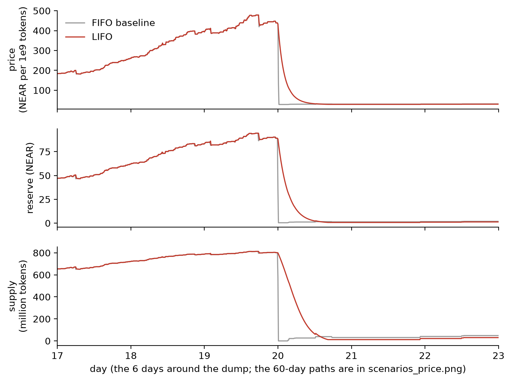

# LIFO: the rules

LIFO is a memecoin with its own market: a bonding curve that sells tokens for NEAR and buys them back from its reserve. Each token carries the date it was bought from that market, its vintage. When more people want out than the reserve lets go in one batch, the reserve pays the newest vintages first and the oldest holders wait. When the gate does not bind, every seller is paid in full in the next batch.

The reference model is [`lifo/model.py`](lifo/model.py); the tests are in [`tests/`](tests/). The figures below come from the simulation in [`lifo/sim.py`](lifo/sim.py) and are **simulated, not market data**.

## The mechanism

1. **One market, one reserve.** Buys go through a constant-product curve with virtual reserves: `X = VIRTUAL_NEAR + reserve`, `Y = VIRTUAL_TOKENS - supply`, `k = X * Y`. A buy executes at once. There is no owner, no admin method, no upgrade method, and no way to change a parameter after launch.
2. **Vintages.** A buy creates a lot of the current vintage (`floor((t - LAUNCH_TIME) / VINTAGE_LENGTH)`). Tokens keep their vintage when transferred. Tokens leave an account newest first. An account holds at most `MAX_LOTS` lots; beyond that its two oldest lots merge into the older vintage. No path makes a token newer: only a buy creates a vintage.
3. **Sell requests.** Selling is a request for the current epoch (`EPOCH_LENGTH`). The tokens are locked, newest first, with their vintages.
4. **The gate.** When an epoch ends, the first call to the contract settles it on the pool as it is then. At most `GATE_BPS` of the reserve can leave in one epoch. If all requests fit, all are filled. If not, vintages are filled from newest to oldest; the vintage where the room runs out is shared pro rata; older vintages get nothing this epoch.
5. **One price per batch.** Every filled token in the batch gets the same price. Unfilled tokens go back to their owners with their vintage. There is no queue carried over: an unfilled seller asks again and is ordered by vintage again.
6. **Claims.** Each request is paid once, when its owner claims or makes its next call. A settlement does work per vintage, not per seller.

## Parameters

Values recommended by the sweep ([`results/RECOMMENDED.md`](results/RECOMMENDED.md)). The curve values are the starting values of the spec, not changed by the simulation.

| Parameter | Value | Meaning |
|---|---|---|
| `VIRTUAL_NEAR` | 30 NEAR | virtual NEAR side of the curve |
| `VIRTUAL_TOKENS` | 1,073,000,000 tokens (18 decimals) | virtual token side |
| `MAX_SUPPLY` | 80 % of `VIRTUAL_TOKENS` | buys that would pass it are refused; this caps the reserve at 4 x `VIRTUAL_NEAR` = 120 NEAR |
| `GATE_BPS` | 500 (5 % of the reserve per epoch) | the gate |
| `EPOCH_LENGTH` | 10 minutes | one batch |
| `VINTAGE_LENGTH` | 1 hour | resolution of the line |
| `SELL_FEE_BPS` | 50 (0.5 %) | stays in the reserve |
| `MAX_LOTS` | 16 | lots per account before merging |

## Rounding

Every rounding favours the reserve.

- Buy: `out = Y - ceil(k / (X + d))`.
- Sell: `gross = X - ceil(k / (Y + f))`, fee `ceil(gross * SELL_FEE_BPS / 10000)`, paid `gross - fee`. The fee stays in the reserve, so `k` never falls.
- Gate: `cap = floor(reserve * GATE_BPS / 10000)`. The largest fill `F` has a closed form (`gate_fill` in the model): with `G = floor(((cap + 1) * 10000 - 1) / (10000 - fee))` and `m = X - G`, `F = floor((k - 1) / (m - 1)) - Y`, or no limit when `m <= 1`. A property test checks `paid(F) <= cap < paid(F + 1)` on 2,000 random pools.
- Boundary vintage: a request's share is `floor((s + a) * f / r) - floor(s * f / r)`, where `s` is what that vintage had requested before it. The shares add up exactly to the vintage's fill, and each is within one token unit of its exact pro rata share.
- Payout per request: `floor(filled * total_paid / total_filled)`. The remainder goes back to the reserve when the last request of the epoch is claimed.
- Solvency: `k` starts at `VIRTUAL_NEAR * VIRTUAL_TOKENS` and never falls, so buying back the whole supply never needs more than the reserve. The property tests check this after every step.

## What the simulation shows

The simulation runs 60 days at epoch resolution with 20 early buyers, one insider who buys first, retail arrivals with random sizes and holding times, a late group of 120 buyers in the three days before day 20, and holders who sell everything when the price falls a drawn fraction below their peak. Each scenario runs on the same seed and the same agents twice: under LIFO, and under a FIFO baseline that has the same curve and fee but executes every sell at once. 10 seeds, 144 parameter sets, 9,000 runs. Full tables: [`results/`](results/).

At the recommended parameters, the late group's NEAR back per NEAR invested (mean of 10 seeds):

| Scenario | LIFO | FIFO | LIFO better on |
|---|---|---|---|
| calm growth | 1.284 | 1.275 | 5 of 10 seeds |
| insider dump at the peak | 0.781 | 0.317 | 10 of 10 |
| panic after a shock | 0.879 | 0.721 | 7 of 10 |
| slow distribution by early holders | 0.710 | 0.653 | 9 of 10 |
| refresh attack | 0.430 | 0.319 | 10 of 10 |

*Insider dump, seed 1, days 17 to 23: under FIFO the price falls in one epoch; under LIFO the gate spreads the fall over hours, and the late group is paid first. Simulated.*

In the 48 hours after the peak of the insider dump, the newest third of vintages got 74 % of the NEAR paid out under LIFO and 32 % under FIFO. The largest one-hour price drop was 34 % under LIFO and 92 % under FIFO.

## Attacks and limits

- **Buying a better seat by round trip.** A holder can sell old tokens and buy fresh ones from a second account. Tokens leave newest first, so it takes a second account, which is free. In the refresh-attack scenario the insider refreshes over the 12 hours before dumping: it cost 0.58 NEAR in fees and added 28.32 NEAR to what the insider got out, compared with dumping without a refresh (10-seed mean). At every fee in the grid (50 to 300 bps) the refresh paid for itself many times ([`results/figures/refresh_cost_benefit.png`](results/figures/refresh_cost_benefit.png)). LIFO does not stop an insider who plans the dump and refreshes first. The late group still did better than under FIFO (0.430 against 0.319) because the gate slows the fall, but far worse than without the refresh (0.781).
- **Early holders are stuck in a crash.** That is the trade. In the insider dump the oldest holders waited up to 16 hours on average for their last fill, and early buyers got 1.275 NEAR back per NEAR against 1.374 under FIFO. In the panic, 1.300 against 1.661.
- **A visible queue.** Anyone can see when the gate binds. The simulation assumes holders panic at 75 % of their usual threshold after a batch where the gate bound. Varying that from 1.0 (no effect) to 0.5 changed the late group's result by under 0.07 NEAR per NEAR ([`results/SENSITIVITY.md`](results/SENSITIVITY.md)); under LIFO, panicking sooner helps the newest sellers, since they are paid first. This is an assumption about behaviour, not a measurement.
- **Calm growth is not better.** The gate bound in a few epochs even in calm growth. The late group's mean was 0.009 higher under LIFO, but LIFO was better on only 5 of 10 seeds, and the worst seed lost 0.034 NEAR per NEAR.
- **Panic is not always better.** On 3 of 10 seeds the late group did worse under LIFO in the panic (worst: 0.073 NEAR per NEAR less).
- **Other venues.** Anyone can open a pool for the token elsewhere, for example on Ref Finance. The rule covers this market's reserve only. Tokens bought elsewhere keep the vintage they were first bought with here, so they do not jump the line.
- **Splitting across accounts** changes payouts only by rounding (at most one token unit and one unit of value per account), tested on 2,000 random cases. An account with more than 16 vintages has its oldest lots merged into older ones; splitting avoids that merge but never gives a token a newer vintage than its purchase.
- **A small market.** With these curve values the reserve cannot pass 120 NEAR. The simulated buyers' sizes were chosen so that the reserve peaks under that cap (about 50 to 95 NEAR).
- **What the simulation is.** Agent behaviour (arrival rates, sizes, thresholds) is drawn from distributions chosen for this model, not fitted to market data.

## Change from the spec

The spec says the boundary vintage is shared pro rata "rounded down" per request. Taken literally that creates tokens: two requests of one unit at a boundary that can fill one unit both round down to zero, the curve has bought one unit, and both sellers get their unit back. The model uses the exact split above instead.
